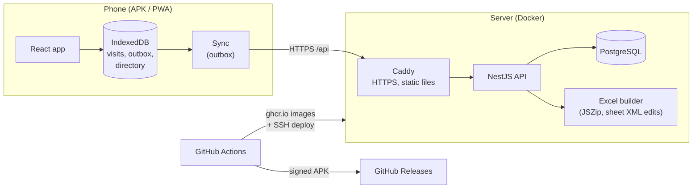

# Vizity — field CRM for a medical rep

**English** | [Русский](README.ru.md)

A mobile app for a pharmaceutical sales rep: log visits to doctors and pharmacies on the go during the day, and in the evening send the monthly Excel report to the manager in one tap — in the very file and format the company sent.

Works offline, installs on Android as an app, and the report goes to WhatsApp through the system share sheet. In daily production use.

<p>
  
  
  
  
</p>
<p>
  
  
  
  
</p>

*All data in the screenshots is fictional. The interface is in Russian — the app is built for a Russian-speaking user.*

## Why

A typical rep's day is 20–30 visits. They usually get written down in a notebook, then retyped in the evening into an Excel template sent by the manager, and the file is sent over WhatsApp. Retyping eats the evening, and the template can't be changed: the company only accepts its own file, under its own name and with its own formatting.

The app removes the retyping: a visit is logged in about half a minute, and the report builds itself — values are written into the empty cells of the original file, and everything else in the workbook stays byte for byte.

## Features

- **Doctor and pharmacy visits.** Autofill from a directory by name (clinic, address, specialty, phone), six product buttons, per-product stock / sold / reorder for pharmacies, quick comment phrases; the agreement from the previous visit carries over automatically.
- **Day plan from the template.** The manager pre-fills where to go in the Excel file; the app shows the plan with visited / not visited marks, and "+" on a plan item opens a visit with the clinic already filled in.
- **One-tap report.** The server builds the file from the original template and the month's visits; the phone opens the system share sheet → WhatsApp. The file name stays exactly as received.
- **Report preview** per day — exactly the rows that will end up in Excel, without sending the file to yourself.
- **Offline.** Visits are written to the phone's storage and sync when a connection appears; the screen always shows whether everything has been sent.
- **Search** within a day, a month or all visits (name, clinic, address, phone by digits), with filters and sorting.
- **Importing an already filled month** from Excel: past visits and the directory are pulled from the file.
- **Invite-only sign-up** with one-time links.

## Engineering highlights

- **Filling a third-party Excel template without breaking it.** Libraries like exceljs re-save the whole workbook and lose external links, renumber styles and leave broken defined names — Excel then offers to "repair" the file. Instead, the xlsx is opened as a zip (JSZip) and only the visits sheet XML is edited: values go into existing empty cells, keeping their style. When a day has more visits than rows, rows are inserted the way Excel does it — shifting cell references, merges, autofilter, selection and workbook defined names. Verified with Excel automation, which fails on a corrupted file.
- **Placement algorithm.** Visits are laid out like a human would fill the plan: planned places first into their own row groups, then unplanned ones into spare rows, then into untouched plan groups, and only then new rows. A "place" is name + address with typo-tolerant street matching (Levenshtein), so branches of a pharmacy chain are not mixed up.
- **Offline-first sync.** Every change goes to IndexedDB first, then a persistent outbox sends it in order; an operation is removed only after the server responds. Last-write-wins by device timestamp, soft deletes (an old edit can't resurrect a deleted visit), idempotent client-generated IDs.
- **Auth.** httpOnly + SameSite=Strict cookies, short-lived access JWT, rotating opaque refresh tokens stored as hashes, with **reuse detection**: a replayed refresh token revokes all of the user's sessions. The client performs a single refresh for all parallel requests, so the rotation never logs the user out by mistake.
- **Android wrapper.** Chrome on Android refuses to share `.xlsx` via the Web Share API (`NotAllowedError`), so a thin Capacitor app uses the native share sheet and a custom plugin to receive the template from WhatsApp. The wrapper loads the production site, so frontend updates ship without reinstalling.
- **CI/CD.** Type checks, lint and tests → multi-arch (amd64 + arm64) Docker images in GHCR → SSH deploy with a health check; signed APK builds to GitHub Releases; nightly database backups with a restore check.

## Tech stack

| Part | Technologies |
|---|---|
| Backend | NestJS 11, TypeScript, Prisma 6, PostgreSQL 16, JSZip (Excel), class-validator, JWT + bcrypt |
| Frontend | React 19, Vite 8, Mantine 9, TanStack Query 5, React Router 7, IndexedDB (`idb`), PWA (vite-plugin-pwa, custom Workbox service worker) |
| Android | Capacitor 8 — native wrapper around the site (Share, Filesystem, custom file-receiving plugin) |
| Infrastructure | Docker, Caddy (HTTPS, reverse proxy), GitHub Actions (CI/CD, images in GHCR, APK build and signing), nightly `pg_dump` backups |
| Quality | Jest (74 tests for report, import and placement logic), ESLint, oxlint, Prettier, strict TypeScript |

## Architecture



In-depth documentation (in Russian):

- [Architecture and data model](docs/architecture.md)
- [Excel report: filling a third-party template without breaking it](docs/excel-report.md)
- [Offline mode and sync](docs/offline.md)
- [Auth and security](docs/auth.md)
- [Android app](docs/android.md)
- [CI/CD](docs/ci-cd.md)
- [Local development](docs/development.md)
- [Server deployment](deploy/README.md)

## Quick start

Requires Node.js 22 and Docker.

```bash
cp .env.example .env
docker compose up -d                  # PostgreSQL on port 5434

cd backend
cp .env.example .env
npm ci
npx prisma migrate deploy
npm run user:create -- admin 'password-8-chars-min' "Ivan Ivanov" --admin
npm run start:dev                     # API at http://localhost:3000/api

cd ../frontend
npm ci
npm run dev                           # http://localhost:5173
```

More in [docs/development.md](docs/development.md) (in Russian).

## Project structure

```
backend/            NestJS API
  prisma/           schema and migrations
  src/auth          sign-in, sessions, invites
  src/visits        visits, offline sync, search
  src/directory     directory of clinics, pharmacies, doctors
  src/templates     template upload and import of filled rows
  src/report        report building, row placement, preview
frontend/           React app (PWA)
  src/offline       IndexedDB, outbox, sync
  src/sw            service worker
  android/          Capacitor Android project
deploy/             server docker-compose, Caddy, backups
.github/workflows/  CI/CD: checks, images, deploy, APK build
```
