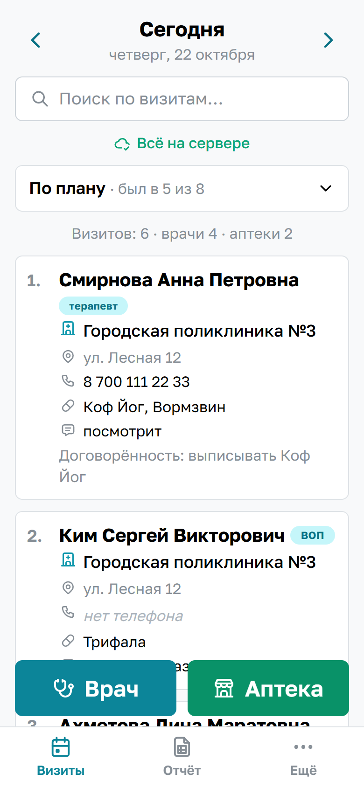
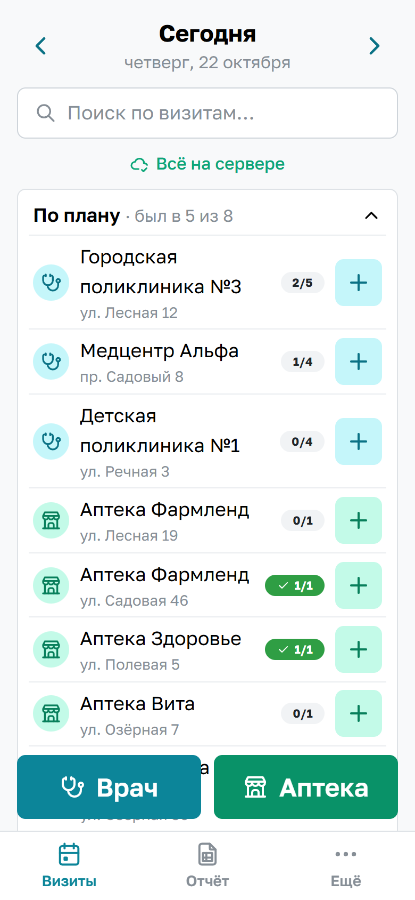
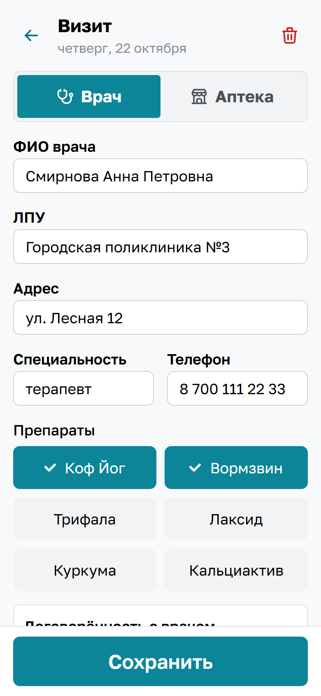
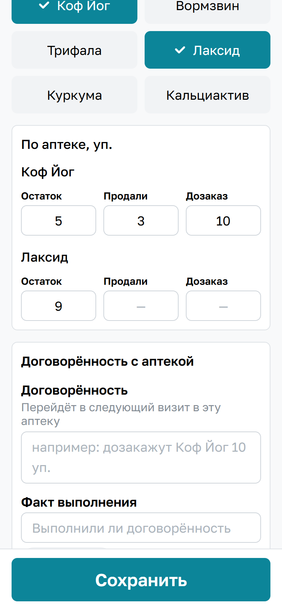
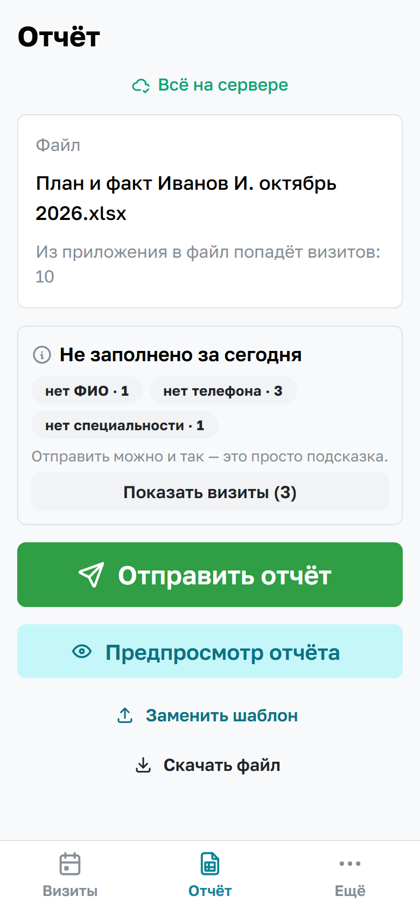
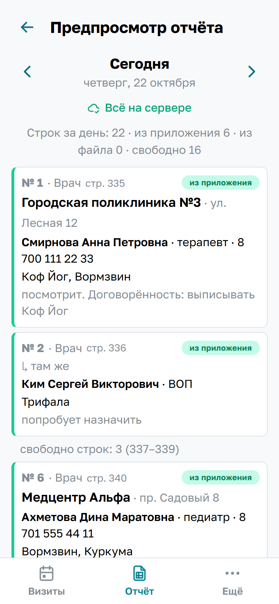
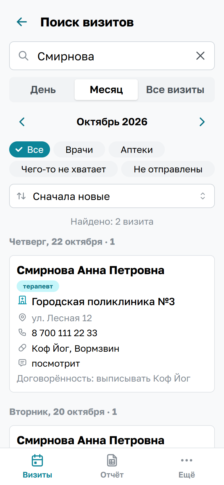
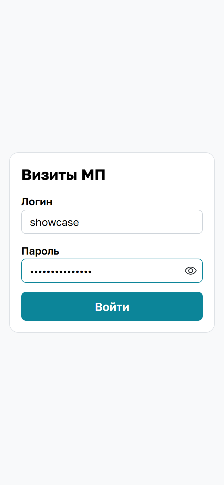
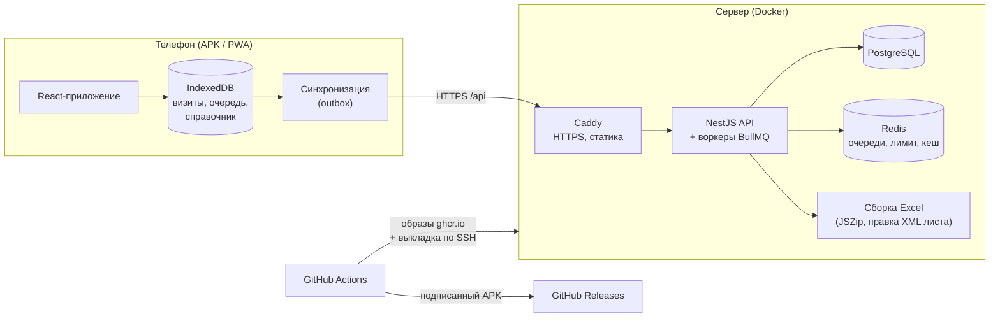
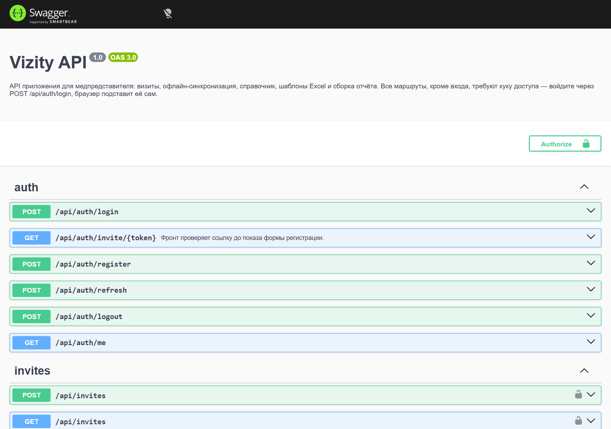

# Визиты МП

[English](README.md) | **Русский**

Мобильное приложение для медицинского представителя: днём быстро записывать визиты к врачам и в аптеки прямо с телефона, вечером одной кнопкой отправлять руководителю месячный отчёт в Excel — в том самом файле и формате, который прислала компания.

Работает без интернета, ставится на Android как приложение, отчёт уходит в WhatsApp через системное «Поделиться».

<p>
  
  
  
  
</p>
<p>
  
  
  
  
</p>

*Все данные на скриншотах вымышлены.*

## Зачем

Типичный день медпредставителя — 20–30 визитов. Обычно их пишут в блокнот, а вечером перепечатывают в Excel-шаблон, который присылает руководитель, и отправляют файл в WhatsApp. Перепечатка занимает вечер, а шаблон менять нельзя: компания принимает только свой файл, под своим именем и в своём оформлении.

Приложение убирает перепечатку: визит записывается на ходу за полминуты, а отчёт собирается сам — значения вписываются в пустые ячейки исходного файла, остальное в книге остаётся байт в байт.

## Что умеет

- **Визиты врачей и аптек.** Автоподстановка из справочника по ФИО (ЛПУ, адрес, специальность, телефон), шесть кнопок препаратов, у аптеки — остаток / продали / дозаказ по каждому препарату, готовые фразы комментария, договорённость с прошлого визита переносится сама.
- **План дня из шаблона.** В Excel руководитель заранее вписывает, куда идти; приложение показывает план с отметками «был / не был», а «+» у пункта плана открывает визит с уже заполненным ЛПУ.
- **Отчёт одной кнопкой.** Сервер собирает файл из оригинала шаблона и визитов месяца, телефон открывает системное «Поделиться» → WhatsApp. Имя файла — исходное.
- **Предпросмотр отчёта** по дням — ровно те строки, что будут в Excel, без отправки файла себе.
- **Без сети.** Визиты пишутся в память телефона и уходят на сервер, когда появится связь; на экране всегда видно, всё ли отправлено.
- **Поиск** по дню, месяцу или всем визитам (ФИО, ЛПУ, адрес, телефон по цифрам), фильтры и сортировка.
- **Загрузка уже заполненного месяца** из Excel: прошлые визиты и справочник подтягиваются из файла.
- **База врачей и аптек** в файле руководителя: все врачи и аптеки из визитов — на свой лист, один человек — одна строка (разные написания одного врача сводятся), с препаратами, которые ему показывали.
- **Приглашения коллег** — регистрация только по одноразовой ссылке.

## Инженерные решения

- **Заполнение чужого Excel-шаблона, не ломая файл.** Библиотеки вроде exceljs пересохраняют книгу целиком и теряют внешние ссылки, перенумеровывают стили, оставляют битые именованные диапазоны — Excel предлагает «восстановить» файл. Вместо этого xlsx открывается как zip (JSZip) и правится только XML листа визитов: значения пишутся в существующие пустые ячейки с их стилем. Если визитов больше, чем строк, строки вставляются так, как это делает Excel, — со сдвигом ссылок, объединений, автофильтра, выделения и именованных диапазонов. Проверено автоматизацией Excel, которая падает на повреждённом файле.
- **Алгоритм раскладки.** Визиты раскладываются так, как заполнил бы план человек: сначала запланированные места — в свои группы строк, потом незапланированные — в запасные строки, потом в нетронутые группы плана, и только потом новые строки. Место — это название + адрес со сравнением улиц с допуском на опечатки (Левенштейн), поэтому филиалы сети аптек не путаются.
- **Offline-first синхронизация.** Любое изменение сначала пишется в IndexedDB, затем постоянная очередь отправляет его по порядку; операция удаляется только после ответа сервера. «Последняя правка побеждает» по времени устройства, мягкое удаление (старая правка не воскрешает удалённый визит), идемпотентные идентификаторы с телефона.
- **Авторизация.** Куки httpOnly + SameSite=Strict, короткий access JWT, ротируемые непрозрачные refresh-токены, хранящиеся хешами, с **обнаружением повторного использования**: переигранный refresh отзывает все сессии пользователя. Клиент делает одно обновление на все параллельные запросы, поэтому ротация никогда не разлогинивает по ошибке.
- **Android-обёртка.** Chrome на Android не даёт делиться `.xlsx` через Web Share API (`NotAllowedError`), поэтому тонкое приложение на Capacitor использует системное «Поделиться» и свой плагин для приёма шаблона из WhatsApp. Обёртка открывает рабочий сайт, так что обновления фронта приходят без переустановки.
- **Redis, очереди и кеш — с запасным режимом.** Импорт шаблона — задача BullMQ (3 попытки с экспоненциальной паузой, идемпотентна, статус опрашивается); ночная уборка — по расписанию BullMQ. Вход ограничен (5 попыток в минуту с IP, затем пауза 5 минут), счётчики в Redis. Готовый отчёт кешируется с **версией в ключе** (загрузка шаблона + число визитов + последняя правка + хеш сборки) — устаревший отчёт отдать невозможно, сбрасывать кеш вручную не нужно. Телефон хранит скачанный файл под той же версией — повторный заход на экран отчёта его не скачивает. Redis упал — всё работает: импорт в запросе, лимит в памяти, без кеша; проверено остановкой Redis посреди работы. BullMQ, а не RabbitMQ, — осознанно: один сервис, Redis уже есть, ~10 МБ вместо ~150 МБ на сервере с 1 ГБ.
- **Тесты.** 98 юнит-тестов (раскладка, вставка строк в Excel, база врачей, разбор импорта, запасные режимы Redis, пути очереди) и 10 сквозных тестов Playwright на настоящем стеке (Postgres + Redis + API + собранный фронт): вход и лимит попыток, визит до сервера, офлайн и синхронизация, поиск, шаблон → план дня → предпросмотр → xlsx, файл базы врачей.
- **CI/CD.** Типы, линтер, юнит-тесты и E2E на сервисах GitHub Actions → Docker-образы под amd64 и arm64 в GHCR → выкладка по SSH с проверкой здоровья; подписанный APK в GitHub Releases; ночные бэкапы базы с проверкой восстановления; документация API в Swagger.

## Стек

| Часть | Технологии |
|---|---|
| Бэкенд | NestJS 11, TypeScript, Prisma 6, PostgreSQL 16, Redis 7, BullMQ, `@nestjs/throttler`, JSZip (Excel), class-validator, JWT + bcrypt, Swagger (OpenAPI) |
| Фронтенд | React 19, Vite 8, Mantine 9, TanStack Query 5, React Router 7, IndexedDB (`idb`), PWA (vite-plugin-pwa, свой service worker на Workbox) |
| Android | Capacitor 8 — нативная обёртка над сайтом (Share, Filesystem, свой плагин приёма файлов) |
| Инфраструктура | Docker, Caddy (HTTPS, reverse proxy), GitHub Actions (CI/CD, образы в GHCR, сборка и подпись APK), ежедневные бэкапы `pg_dump` |
| Качество | Jest (98 юнит-тестов), Playwright (10 сквозных тестов на настоящем стеке), ESLint, oxlint, Prettier, строгий TypeScript |

## Архитектура



Подробно:

- [Архитектура и модель данных](docs/architecture.md)
- [Отчёт в Excel: как заполняется чужой шаблон, не ломая файл](docs/excel-report.md)
- [Работа без интернета и синхронизация](docs/offline.md)
- [Авторизация и безопасность](docs/auth.md)
- [Android-приложение](docs/android.md)
- [Redis, очереди и кеш](docs/redis-queues.md)
- [CI/CD](docs/ci-cd.md)
- [Локальная разработка](docs/development.md)
- [Развёртывание на сервер](deploy/README.md)

## Быстрый старт

Нужны Node.js 22 и Docker.

```bash
cp .env.example .env
docker compose up -d                  # PostgreSQL на порту 5434, Redis на 6380

cd backend
cp .env.example .env
npm ci
npx prisma migrate deploy
npm run user:create -- admin 'пароль-от-8-символов' "Иванов Иван" --admin
npm run start:dev                     # API на http://localhost:3000/api

cd ../frontend
npm ci
npm run dev                           # http://localhost:5173
```

Документация API (Swagger): http://localhost:3000/api/docs. Сквозные тесты и подробности — в [docs/development.md](docs/development.md).



## Структура

```
backend/            NestJS API
  prisma/           схема и миграции
  src/auth          вход, сессии, приглашения
  src/visits        визиты, офлайн-синхронизация, поиск
  src/directory     справочник ЛПУ, аптек, врачей
  src/templates     загрузка шаблона и импорт заполненных строк
  src/report        сборка отчёта, раскладка по строкам, предпросмотр, кеш отчёта
  src/redis         подключение к Redis с запасным режимом
  src/maintenance   уборка по расписанию (BullMQ)
frontend/           React-приложение (PWA)
  src/offline       IndexedDB, очередь отправки, синхронизация
  src/sw            service worker
  android/          Capacitor-проект Android
e2e/                сквозные тесты Playwright
deploy/             docker-compose для сервера, Caddy, бэкапы
.github/workflows/  CI/CD: проверки, образы, выкладка, сборка APK
```
