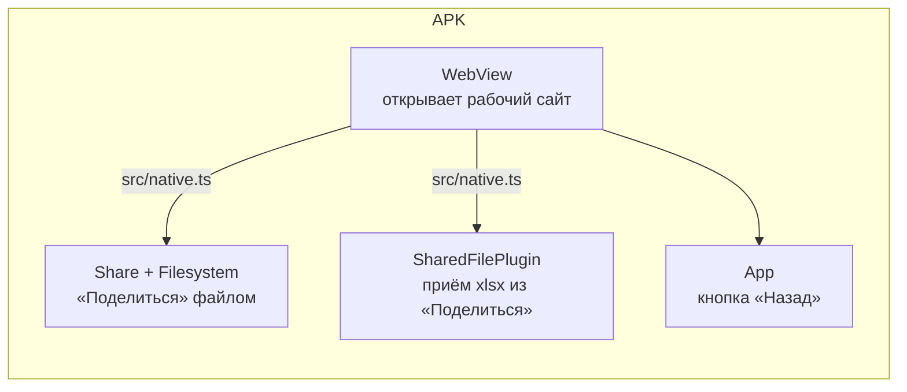

# Android-приложение

## Зачем обёртка, если есть PWA

Главная функция — «Отправить отчёт» в WhatsApp через системное «Поделиться». В браузере это делает Web Share API, но **Chrome на Android не разрешает делиться файлами `.xlsx`**: этого типа нет в его списке разрешённых, и `navigator.share` падает с `NotAllowedError`. На iPhone Safari такой файл отдаёт без проблем, на Android — нет.

Нативное приложение этого ограничения не имеет, поэтому сделана тонкая обёртка на **Capacitor 8** (`frontend/android`).

## Как устроено

- **Внутри — тот же сайт.** `server.url` в `capacitor.config.ts` указывает на рабочий адрес (передаётся при сборке через `APP_URL`), поэтому обычные правки фронта приходят в приложение с выкладкой сайта, без переустановки. Пересобирать APK нужно только при изменении нативной части или адреса.
- **`src/native.ts`** — единственная точка, где сайт обращается к Android; в браузере все функции просто не используются (`isNative === false`):
  - `nativeShareFile` — пишет файл во временную папку **ровно под исходным именем** и открывает системное «Поделиться»;
  - `nativeShareText` — ссылка-приглашение;
  - `listenSharedFiles` — файл шаблона, присланный из WhatsApp («Поделиться» → «Визиты»);
  - `handleBackButton` — «Назад» идёт по истории экранов, с первого экрана сворачивает приложение (не закрывает, чтобы не оборвать отправку очереди).
- **`SharedFilePlugin.java`** — свой плагин: интент-фильтр `ACTION_SEND` для xlsx в манифесте, чтение файла (до 20 МБ), передача в WebView. Дальше файл кладётся туда же, куда его кладёт service worker в PWA, и обрабатывается тем же кодом.
- Системные отступы (полоса жестов, вырезы) берутся через `env(safe-area-inset-*)`; нижняя панель — sticky, а не fixed, поэтому не перекрывает контент на любом размере экрана и при крупном системном шрифте.

## Сборка и подпись

`.github/workflows/android.yml` — запускается при изменениях нативной части или вручную:

1. сборка фронта и `npx cap sync android` с адресом из переменной репозитория `APP_DOMAIN`;
2. `gradlew assembleRelease` (JDK 21, Android SDK 36);
3. подпись ключом из секретов GitHub (`ANDROID_KEYSTORE_BASE64`, пароли, alias);
4. публикация `vizity.apk` в GitHub Releases.

`versionCode` = номер запуска CI, поэтому новая сборка ставится поверх старой с сохранением данных. Ключ подписи один навсегда: APK, подписанный другим ключом, Android поверх старого не установит. Сам ключ хранится вне репозитория.

Локальная сборка: Gradle 8.14 + JDK 21 + Android SDK 36 (удобно в Docker-образе `eclipse-temurin:21-jdk`).
