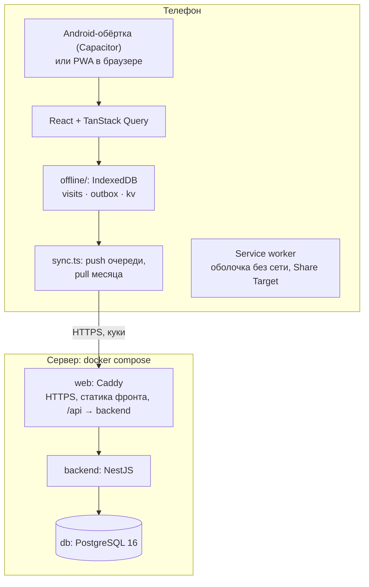
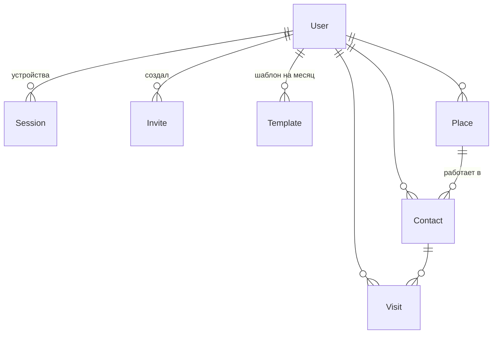

# Архитектура

## Общая схема

- **Фронт и API на одном домене**: Caddy отдаёт собранный фронт и проксирует `/api/*` на бэкенд. Это нужно для кук `SameSite=Strict` — токены живут только в `httpOnly`-куках, JavaScript их не видит.
- **Телефон — источник правды для экранов.** Списки визитов и справочник читаются только из IndexedDB, поэтому интерфейс одинаково работает с сетью и без неё. Сервер — общее хранилище и место сборки отчёта. См. [offline.md](offline.md).
- **Отчёт собирается на сервере** из оригинала шаблона и визитов месяца — каждый раз заново, файл нигде не хранится в изменённом виде. См. [excel-report.md](excel-report.md).

## Бэкенд (NestJS)

Модули по предметным областям, бизнес-логика Excel — в чистых функциях без зависимостей от Nest (их легко тестировать).

| Модуль | Что делает |
|---|---|
| `auth` | вход по логину и паролю, access JWT + refresh-сессии, приглашения, глобальный guard |
| `visits` | CRUD визитов, офлайн-синхронизация (`PUT/DELETE /visits/sync/:clientId`), поиск по всем месяцам |
| `directory` | справочник ЛПУ, аптек, врачей и провизоров; пополняется каждым визитом |
| `templates` | загрузка Excel-шаблона месяца, импорт уже заполненных строк в визиты |
| `report` | раскладка визитов по строкам, сборка xlsx, предпросмотр дня, план дня |
| `common` | даты, пайпы, сравнение мест (название + адрес) |
| `prisma` | доступ к базе |

Ключевые файлы:

- `src/report/xlsx-template.ts` — разбор листа, поиск дней, раскладка (`placeDay`), вставка строк, запись XML, предпросмотр.
- `src/templates/row-import.ts` — нечёткое распознавание препаратов в тексте, который люди пишут в Excel руками.
- `src/common/place-match.ts` — одно ли это место (название + адрес с допуском на опечатки).

## Фронтенд (React)

| Папка / файл | Что там |
|---|---|
| `src/pages` | экраны: день, визит, поиск, отчёт, предпросмотр, «Ещё», вход, регистрация по приглашению |
| `src/components` | `Layout` (нижнее меню), `VisitCard`, `SyncBadge`, подсказка «Не заполнено» |
| `src/api` | `client.ts` — fetch с авто-обновлением токена; `queries.ts` — хуки TanStack Query |
| `src/offline` | `db.ts` (IndexedDB), `sync.ts` (очередь и синхронизация), `local.ts` (чтение) |
| `src/sw/sw.ts` | свой service worker: кеш оболочки, навигация без сети, приём файла из «Поделиться» |
| `src/native.ts` | мост к Android: «Поделиться» файлом, приём файла, кнопка «Назад» |

Интерфейс рассчитан на использование на ходу и людей 50+: крупные размеры компонентов Mantine по умолчанию, кнопки под большой палец, шрифт Golos Text лежит в приложении (работает без сети).

### Экраны

| Путь | Экран |
|---|---|
| `/`, `/day/:date` | визиты дня, план дня из шаблона, листание по будням |
| `/visit/new`, `/visit/:clientId` | форма визита — отдельная страница, чтобы системная «Назад» её закрывала |
| `/search` | поиск: день / месяц (в памяти телефона) / все визиты (сервер), фильтры, сортировка |
| `/report` | загрузка шаблона, проверка, «Отправить отчёт» |
| `/report/preview` | предпросмотр строк дня как в готовом файле |
| `/more` | приглашения коллег (для админа), выход |
| `/login`, `/invite/:token` | вход и регистрация по приглашению |

## Модель данных

| Таблица | Поля и смысл |
|---|---|
| `User` | логин, хеш пароля (bcrypt), ФИО, `isAdmin` |
| `Session` | refresh-сессия устройства: хеш секрета, user agent, срок |
| `Invite` | одноразовое приглашение: sha256 токена, срок, кем использовано |
| `Template` | оригинал Excel-файла месяца **байт в байт** и исходное имя; один на пользователя и месяц |
| `Place` | ЛПУ или аптека: название, адрес, последняя договорённость (для аптек) |
| `Contact` | врач или провизор: ФИО, специальность, телефон, место, последняя договорённость |
| `Visit` | **снимок** полей строки отчёта на момент визита (место, адрес, ФИО, специальность, телефон), препараты JSON, комментарий, договорённость / факт / отклонение, `clientId` с телефона, время правки на устройстве, мягкое удаление, номер строки в файле для визитов «из файла» |

Визит хранит снимок, а не только ссылки на справочник: если врач сменил телефон или место, старые отчёты не меняются задним числом.

Все данные привязаны к `userId` с первого дня — несколько медпредставителей работают в одной системе независимо.

## API

Все маршруты под `/api`, все кроме входа — только с access-кукой.

| Метод и путь | Назначение |
|---|---|
| `POST /auth/login`, `/auth/register`, `/auth/refresh`, `/auth/logout`, `GET /auth/me` | вход, регистрация по приглашению, обновление токена, выход, профиль |
| `GET /auth/invite/:token` | проверка приглашения |
| `POST /invites`, `GET /invites`, `DELETE /invites/:id` | приглашения (только админ) |
| `GET /visits?date=` / `?month=` | визиты дня или месяца |
| `PUT /visits/sync/:clientId`, `DELETE /visits/sync/:clientId` | офлайн-синхронизация: создать/обновить, мягко удалить |
| `GET /visits/search?q=` | поиск по всем месяцам |
| `GET /directory` | весь справочник — для подсказок без сети |
| `POST /templates`, `GET /templates`, `DELETE /templates/:month` | шаблоны месяцев |
| `GET /plan?date=` | план дня из шаблона с отметками «занято» |
| `GET /reports/:month/check` | сколько визитов попадёт в файл, предупреждения |
| `GET /reports/:month` | готовый xlsx под исходным именем |
| `GET /reports/preview?date=` | строки дня как в готовом файле |
