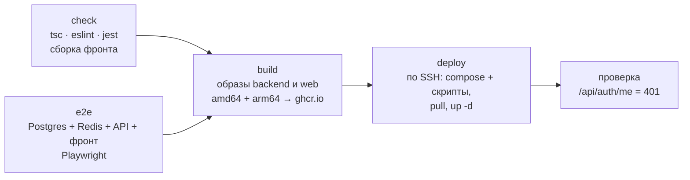

# CI/CD

## Выкладка сайта и API (`.github/workflows/deploy.yml`)

На каждый push в `main`:



1. **check** — типы, линтер и юнит-тесты бэкенда, сборка фронта. Не прошло — на сервер ничего не уходит.
1. **e2e** (параллельно с check) — сквозные тесты Playwright на настоящем стеке: сервисы GitHub Actions поднимают Postgres и Redis, запускаются бэкенд (с миграциями и тестовым пользователем) и собранный фронт в `vite preview`. Проверяются вход и выход, лимит попыток входа, запись визита до сервера, офлайн-режим и синхронизация, поиск, загрузка шаблона → план дня → предпросмотр → готовый xlsx. При падении в артефакты уходят отчёт Playwright (трейсы, скриншоты) и лог бэкенда.
2. **build** — ждёт check и e2e. Docker-образы `backend` (NestJS) и `web` (Caddy с собранным фронтом) под **amd64 и arm64**, публикация в приватный реестр GitHub Container Registry с метками `latest` и хешем коммита; кеш слоёв в GitHub Actions. В образ бэкенда передаётся хеш коммита (`APP_BUILD`) — он входит в ключ кеша отчёта.
3. **deploy** — по SSH на сервер: копируются `docker-compose.prod.yml` и скрипты бэкапа, скачиваются образы (с временным токеном этого запуска — на сервере нет долгоживущих паролей реестра), контейнеры перезапускаются.
4. **проверка** — до 2,5 минут ждём, что API отвечает `401` без входа: значит, Caddy, бэкенд и база живы. Не ответил — в логе запуска печатаются состояние контейнеров и логи бэкенда.

Сервер ничего не собирает сам — хватает машины с 1 ГБ памяти. Миграции базы применяются при старте бэкенда (`prisma migrate deploy`), HTTPS-сертификат Caddy получает и продлевает сам.

**Откат** — любой прошлой версией, она помечена хешем коммита:

```bash
IMAGE_TAG=<хеш коммита> docker compose -f docker-compose.prod.yml up -d --no-build
```

### Настройки репозитория

| Тип | Имя | Значение |
|---|---|---|
| Variable | `DEPLOY_HOST` | адрес сервера |
| Variable | `DEPLOY_USER` | пользователь SSH |
| Variable | `APP_DOMAIN` | домен сайта (для сборки APK) |
| Secret | `DEPLOY_SSH_KEY` | отдельный SSH-ключ только для выкладки |
| Secret | `ANDROID_KEYSTORE_BASE64`, `ANDROID_KEYSTORE_PASSWORD`, `ANDROID_KEY_ALIAS`, `ANDROID_KEY_PASSWORD` | подпись APK |

Пока `DEPLOY_HOST` не задан, работают только проверки и сборка образов.

## Android (`.github/workflows/android.yml`)

См. [android.md](android.md#сборка-и-подпись).

## На сервере

- `docker compose`: `db` (PostgreSQL 16.15), `redis` (7.4.11: очереди, лимит входа, кеш; наружу порт закрыт; бэкенд работает и без него), `backend`, `web` (Caddy: HTTPS, статика, `/api` → backend, заголовки безопасности, сжатие, кеш статики с хешами в именах на год, `index.html` и service worker — без кеша).
- Ежедневный бэкап `pg_dump` по cron с проверкой, что копия читается (`pg_restore --list`), хранение 14 дней; если задан `BACKUP_REMOTE` — копия во внешнее хранилище через rclone.
- Версии образов закреплены точно (`postgres:16.15-alpine`, `redis:7.4.11-alpine`): «16-alpine» при выкладке подтягивал бы новый минорный выпуск и перезапускал базу.
- Пошаговая настройка сервера — [deploy/README.md](../deploy/README.md).
