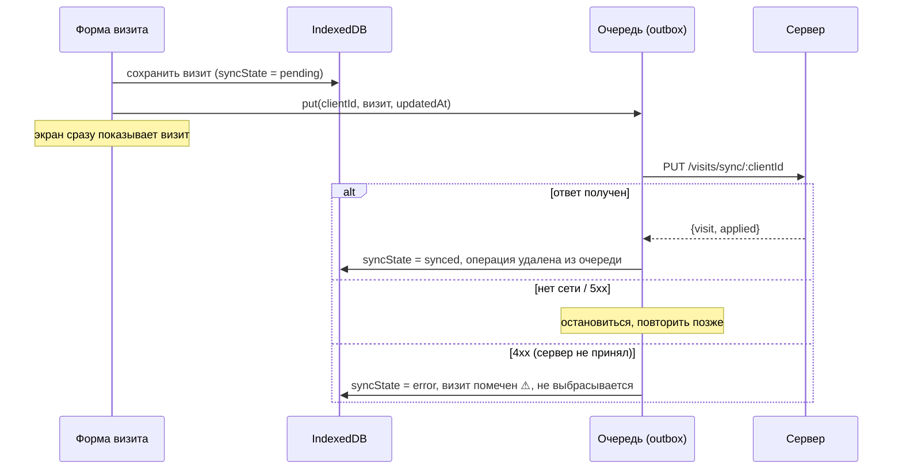

# Работа без интернета

Медпред ходит по поликлиникам, где связи часто нет — в подвалах, лифтах, между этажами. Поэтому приложение построено по принципу **offline-first**.

## Главное правило

**Визит сначала пишется в память телефона (IndexedDB), потом уходит на сервер. Из очереди операция удаляется только после ответа сервера.** Экраны визитов и справочника читают только из памяти телефона — интерфейс одинаков с сетью и без неё.

## Хранилище на телефоне (`frontend/src/offline/db.ts`)

База IndexedDB (через библиотеку `idb`):

| Хранилище | Что в нём |
|---|---|
| `visits` | визиты по `clientId`, индексы «пользователь + день» и «пользователь + месяц»; `syncState`: pending / synced / error |
| `outbox` | очередь операций put / delete / загрузка шаблона — строго по порядку, привязана к пользователю |
| `kv` | справочник для подсказок, последний известный план дня, профиль пользователя, файл из «Поделиться» |

## Синхронизация (`sync.ts`)

**Отправка (push).** Очередь отправляется по порядку. Временная ошибка или нет сети — остановка и повтор: при событии `online`, при возврате в приложение и каждые 30 секунд. Ответ 4xx — операция помечается ошибкой, визит получает значок ⚠ и остаётся на телефоне; исправленное сохранение заменяет отвергнутые операции.

**Получение (pull).** С сервера подтягивается **месяц целиком** — так приходят правки и удаления с других устройств. Визиты с неотправленными изменениями не перезаписываются.

**Конфликты — «последняя правка побеждает».** Каждая операция несёт время правки на устройстве (`updatedAt`). Сервер применяет изменение, только если оно новее того, что у него есть (`clientUpdatedAt` / `deletedAt`); ответ `applied: false` означает, что на сервере правка новее. Удаление мягкое (`deletedAt`): старая правка с другого телефона не «воскрешает» удалённый визит.

**Идемпотентность.** `clientId` генерируется на телефоне и уникален, поэтому повтор того же запроса (например, после обрыва связи посреди ответа) не создаёт дубликат.

## Что работает без сети

| Функция | Без сети |
|---|---|
| Запись, правка, удаление визитов | да, уходит в очередь |
| Список визитов, поиск по дню и месяцу | да |
| Подсказки врачей и мест | да, из сохранённого справочника |
| План дня | последний известный, с пометкой |
| Вход | профиль из кеша — без сети не выкидывает на экран входа |
| Загрузка шаблона из «Поделиться» | ставится в очередь |
| Отчёт и предпросмотр | нет — их собирает сервер |
| Поиск по всем месяцам | нет — идёт на сервер |

Пока в очереди есть неотправленное, кнопка «Отправить отчёт» заблокирована с объяснением: иначе в файл не попали бы последние визиты. Выход из учётной записи очередь не удаляет — она уйдёт после входа тем же логином.

Плашка состояния всегда на виду: «Всё на сервере» / «N ждут отправки · нет сети» / «Сервер не принял: N» (нажатие — повторить).

## Service worker (`frontend/src/sw/sw.ts`)

Свой service worker (vite-plugin-pwa в режиме `injectManifest`, Workbox):

- предзагрузка оболочки приложения — оно открывается без сети;
- навигация SPA без сети отдаёт `index.html`;
- приём `POST /share-target`: файл шаблона из «Поделиться» сохраняется в `kv`, затем редирект на экран отчёта;
- API **не кешируется** — данные живут в IndexedDB, а не в HTTP-кеше.

После входа приложение просит `navigator.storage.persist()`, чтобы браузер не очистил данные при нехватке места.
