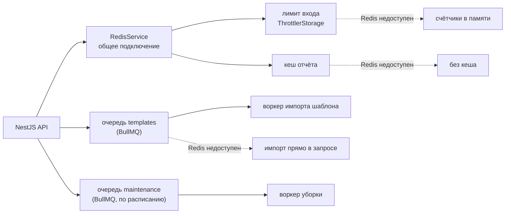

# Redis, очереди и кеш

Redis в проекте решает три задачи: ограничение попыток входа, фоновые задачи (BullMQ) и кеш готового отчёта. Главное правило: **Redis необязателен.** Если он не настроен или упал, приложение работает в упрощённом режиме — визиты, синхронизация и отчёт не ломаются.



## Подключение и запасные режимы

- `src/redis/redis.config.ts` — `REDIS_URL`. Пусто — модули очередей вообще не подключаются (решается при старте; поэтому `main.ts` загружает `.env` раньше всех модулей).
- `src/redis/redis.service.ts` — общий клиент ioredis для лимита и кеша:
  - `enableOfflineQueue: false` — при обрыве команды **не копятся** в клиенте, а сразу падают; вызывающий код ловит ошибку и работает без Redis;
  - сам переподключается с нарастающей паузой;
  - в лог пишет только смену состояния («недоступен» / «снова доступен»), а не каждую попытку.
- У BullMQ свои подключения. Ошибки очередей и воркеров перехватываются и пишутся коротко, не чаще раза в минуту (`quiet-errors.ts`) — без этого BullMQ печатает полный стек на каждую попытку переподключения.

| Функция | С Redis | Без Redis |
|---|---|---|
| Лимит попыток входа | счётчики в Redis — общие для всех экземпляров бэкенда, переживают перезапуск | в памяти процесса |
| Импорт строк шаблона | фоновая задача, ответ на загрузку сразу | прямо в запросе загрузки |
| Кеш отчёта | готовый файл из кеша | каждый раз собирается заново |
| Ночная уборка | по расписанию | не выполняется |

Проверено вживую: Redis останавливался посреди работы — вход, загрузка шаблона и отчёт продолжали работать; после запуска Redis всё переключилось обратно само.

## Ограничение попыток входа

`@nestjs/throttler` с хранилищем `ResilientThrottlerStorage` (`src/auth/throttler-storage.ts`): Redis через `@nest-lab/throttler-storage-redis`, при любой ошибке — память.

- вход и регистрация: **5 попыток в минуту с одного IP**, дальше — пауза 5 минут (даже с верным паролем);
- проверка ссылки-приглашения: 20 в минуту;
- обновление токена, выход и профиль не ограничены — приложение вызывает их постоянно;
- IP клиента — из `X-Forwarded-For`, но доверяем только прокси из своей сети (`trust proxy: loopback, linklocal, uniquelocal`): снаружи подделать адрес нельзя, Caddy перезаписывает заголовок.

Почему хранилище в Redis, а не в памяти: при нескольких экземплярах бэкенда у каждого была бы своя память, и лимит умножался бы на их число.

## Очередь импорта шаблона (BullMQ)

Загрузка Excel-шаблона раньше держала HTTP-запрос, пока сотни заполненных строк превращались в визиты и пополняли справочник. Теперь (`templates.service.ts`, `template-import.processor.ts`):

1. `POST /templates` — файл проверяется и сохраняется **сразу**: ошибки формата пользователь видит в ответе;
2. импорт строк ставится задачей в очередь `templates`, ответ — `{ import: { status: 'queued', jobId } }`;
3. фронт опрашивает `GET /templates/import/:jobId` до `done` / `failed` и после этого забирает визиты месяца на телефон;
4. воркер берёт файл из базы (в Redis — только `userId` и месяц), импортирует в одной транзакции.

Свойства задачи:

- **3 попытки** с экспоненциальной паузой (2, 4, 8 с);
- **идемпотентна**: импорт сначала удаляет прошлые визиты «из файла» этого месяца и читает строки заново, поэтому повтор, ретрай или двойная постановка дают тот же результат;
- `concurrency: 1` — импорты не мешают друг другу;
- выполненные задачи хранятся час, упавшие — неделю (для разбора);
- статус чужой задачи не отдаётся (404).

Если очередь недоступна — Redis заведомо лежит или постановка не ответила за 2 секунды — импорт выполняется прямо в запросе, как раньше. Ответ тогда сразу `{ import: { status: 'done', created, linked } }`.

### Почему BullMQ, а не RabbitMQ

- Приложение — один сервис. RabbitMQ нужен, когда несколько независимых сервисов обмениваются сообщениями (маршрутизация, обменники, разные языки); здесь это лишняя движущаяся часть.
- BullMQ работает поверх Redis, который уже нужен для лимита и кеша, — новой инфраструктуры не появляется.
- RabbitMQ (Erlang) занимает от ~150 МБ памяти; сервер — 1 ГБ на всё. Redis с очередями — единицы мегабайт.
- BullMQ даёт из коробки то, что здесь нужно: повторы с паузой, задачи по расписанию, статус задачи, хранение истории.

## Задачи по расписанию

Очередь `maintenance` (`src/maintenance`): **каждую ночь в 21:00 UTC** (02:00 по UTC+5) удаляются истёкшие refresh-сессии (сами по себе они удаляются только при предъявлении, и таблица росла с каждым входом) и неиспользованные приглашения, истёкшие больше 30 дней назад.

Расписание — `upsertJobScheduler` в BullMQ: хранится в Redis, поэтому при нескольких экземплярах бэкенда задача выполнится один раз, а повторный старт не создаёт дубликат.

## Кеш отчёта

Сборка отчёта — разбор xlsx, раскладка визитов по строкам и запись XML, а экран «Отчёт» при каждом открытии запрашивает и проверку, и сам файл. Готовый отчёт кешируется в Redis на сутки (`report-cache.service.ts`).

**Инвалидация — версией в ключе, а не удалением:**

```
report:<userId>:<месяц>:<шаблон>:<время загрузки шаблона>:<число визитов месяца>:<последняя правка>:<сборка бэкенда>
```

- новый, изменённый или удалённый визит меняет число визитов или время последней правки (удаление мягкое — тоже правка);
- повторная загрузка шаблона меняет время загрузки;
- новая версия бэкенда (хеш коммита `APP_BUILD`, передаётся в образ из CI) — новый ключ, чтобы новая логика раскладки не отдала отчёт, собранный старой.

Любое изменение даёт новый ключ, старый просто истекает. Отдать устаревший отчёт невозможно, и нет мест в коде, где можно забыть «сбросить кеш». Цена — один лёгкий агрегирующий запрос к базе на каждое обращение.

Замер на демо-данных: сборка 128 мс → из кеша 10 мс.

### Версия отчёта на телефоне

Та же версия (короткий хеш) уходит фронту: в ответе проверки (`GET /reports/:month/check` → `version`) и в заголовке файла (`X-Report-Version`). Телефон хранит скачанный файл **под версией** (TanStack Query, ключ с версией, `staleTime: Infinity`):

- повторный заход на экран «Отчёт» без изменений — один маленький запрос проверки, файл не скачивается;
- визиты изменились (в том числе с другого устройства) — новая версия, файл скачивается один раз;
- пока идёт проверка, экран показывает прошлые данные с пометкой «обновляю», а кнопка «Отправить отчёт» ждёт ответа: визит мог только что уйти на сервер, и тогда файл на телефоне — старой версии. Проверка не удалась — отправка тоже недоступна, свежесть файла неизвестна;
- неотправленные визиты на телефоне, как и раньше, блокируют отправку.

Версия считается сервером **до** чтения визитов, поэтому файл никогда не старее своей версии: худший исход — лишнее скачивание, а не устаревший отчёт. Проверено e2e-тестом: заход → уход → заход без запроса файла; новый визит → ровно одно скачивание, в файле — новый визит.

## Настройка

| Где | Что |
|---|---|
| `docker-compose.yml` (разработка) | Redis `7.4.11-alpine` на порту 6380 |
| `backend/.env` | `REDIS_URL=redis://localhost:6380` (пусто — без Redis) |
| `deploy/docker-compose.prod.yml` | контейнер `redis`, `REDIS_URL=redis://redis:6379`, наружу порт не открыт |

Redis запускается с `appendonly yes` (задачи очереди переживают перезапуск), `maxmemory 64mb` и `maxmemory-policy noeviction` — этого требует BullMQ: вытеснение ключей потеряло бы задачи. Бэкенд не ждёт здоровья Redis при старте (`required: false`).

## Тесты

- `redis/redis-fallbacks.spec.ts` — лимит и кеш при недоступном или сбоящем Redis, смена ключа кеша при правках, файл переживает запись и чтение;
- `templates/template-import.spec.ts` — выбор пути импорта: очередь / сразу / таймаут / ошибка очереди, чужая задача;
- `maintenance/maintenance.service.spec.ts` — что именно удаляет уборка;
- e2e `auth.spec.ts` — лимит попыток входа на настоящем стеке.
